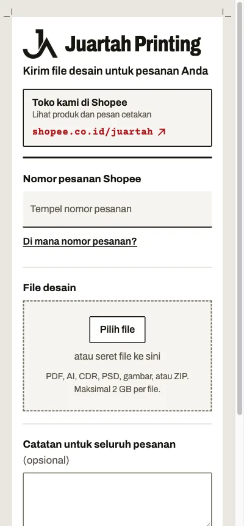
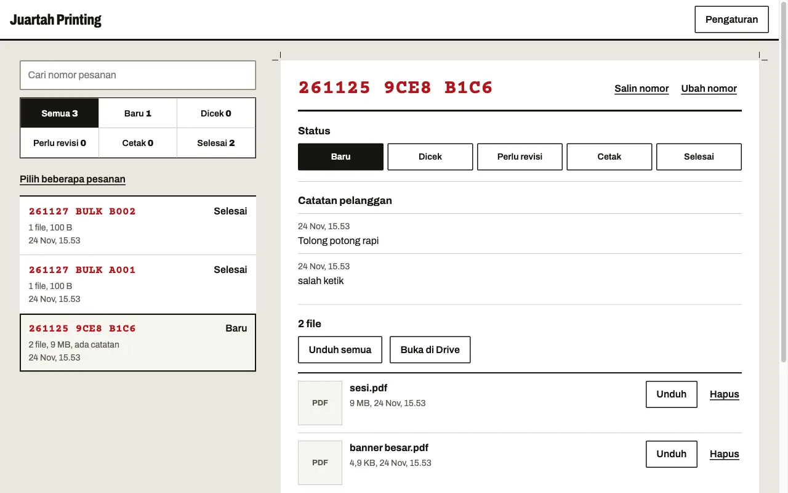

# Juartah Upload

Web kirim file desain untuk percetakan yang berjualan di Shopee. Pelanggan cukup memasukkan nomor pesanan dan memilih file, tanpa akun dan tanpa kirim lewat chat. File masuk ke Google Drive toko, rapi per pesanan, dan dikelola dari dashboard admin.

Dipakai di produksi oleh Juartah Printing di [juartah.my.id](https://juartah.my.id).

[](https://developers.cloudflare.com/workers/)
[](https://hono.dev)
[](https://preactjs.com)
[](https://www.typescriptlang.org)
[](https://vite.dev)
[](https://developers.google.com/drive)
[](./LICENSE)
[](https://juartah.my.id)

<p>
  
  
</p>

---

## Fitur

### Untuk pelanggan
- **Tanpa akun:** cukup nomor pesanan Shopee. Nomor yang polanya tidak lazim diminta dicek ulang supaya file tidak nyasar.
- **Upload besar yang tahan sinyal buruk:** file dipecah per 4 MB dan dilanjutkan dari potongan terakhir kalau koneksi putus. File yang sama tidak terkirim dobel.
- **Cek file sebelum dikirim:** peringatan untuk PDF yang dikunci password, file kosong dari Drive/iCloud, dan gambar dari WhatsApp yang sudah diperkecil.
- **Potong gambar di HP** dengan rasio bebas, persegi, atau A4/A3, plus perkiraan DPI hasil cetak.
- **Cek status pesanan** dan pesan revisi dari toko, lalu tambah file kapan saja.
- **Catatan per file dan per pesanan** untuk instruksi cetak.

### Untuk toko
- **File langsung ke Google Drive toko,** satu folder per pesanan, lengkap dengan file catatan pelanggan.
- **Dashboard pesanan** dengan status Baru, Dicek, Perlu revisi, Cetak, dan Selesai, pencarian nomor, penanda file baru, dan ubah status banyak pesanan sekaligus.
- **Template pesan revisi** (resolusi kecil, belum ada bleed, font belum di-outline, dan lain-lain) yang bisa diubah sendiri.
- **Gabung pesanan** kalau pelanggan salah ketik nomor.
- **Staf** yang masuk dengan akun Google, dengan izin hapus file yang diatur pemilik.
- **Perawatan otomatis:** upload macet dibersihkan, folder kosong dan pesanan selesai bisa dipindah ke Trash setelah sekian hari.
- **Pengaturan** nama toko, teks pembuka, dan batas ukuran file dari dashboard.

### Keamanan & privasi
- Akses Drive hanya `drive.file`: aplikasi hanya melihat file yang dibuatnya sendiri.
- Token Google disimpan terenkripsi di D1. Tidak ada secret di repo.
- Rate limit dan Cloudflare Turnstile (opsional) di endpoint publik.
- CSP ketat, tanpa script pihak ketiga selain Turnstile.
- Halaman [kebijakan privasi](./src/web/privasi/index.html) siap pakai.

## Stack

| Bagian | Teknologi |
|---|---|
| Server & API | [Hono](https://hono.dev) di Cloudflare Workers |
| Database | Cloudflare D1 (SQLite) |
| Penyimpanan file | Google Drive API, resumable upload |
| Frontend | Preact + Vite, CSS biasa |
| Login admin | Google OAuth |
| Anti-bot | Cloudflare Turnstile, Workers Rate Limiting |
| Uji | Vitest (unit) dan skrip E2E dengan Google tiruan |

Struktur folder dan alur upload dijelaskan di [docs/architecture.md](./docs/architecture.md). Arah desain visual ada di [DESIGN.md](./DESIGN.md).

## Mulai cepat

Butuh Node.js 22 atau lebih baru. Tidak perlu akun Google atau Cloudflare untuk mencoba di lokal, karena tersedia server Google tiruan.

```bash
npm install
cp .dev.vars.example .dev.vars
npm run mock        # terminal 1: Google tiruan (FLAKY=1 npm run mock untuk mensimulasikan sinyal buruk)
npm run dev         # terminal 2: http://localhost:8787 dan http://localhost:8787/admin/
```

Masuk ke admin dengan memilih `owner@example.test` di halaman Google tiruan.

```bash
npm run typecheck
npm test
node dev/e2e.mjs    # terminal 3, butuh database lokal kosong
```

## Dokumentasi

| Dokumen | Isi |
|---|---|
| [Deploy ke Cloudflare](./docs/deployment.md) | Google Cloud, Turnstile, D1, secret, custom domain, dan GitHub Actions |
| [Arsitektur](./docs/architecture.md) | Struktur folder, alur upload, data, dan hal yang perlu diketahui |

## Berkontribusi

Pull request dan laporan bug sangat diterima. Baca [CONTRIBUTING.md](./CONTRIBUTING.md) dulu. Celah keamanan dilaporkan secara privat sesuai [SECURITY.md](./SECURITY.md).

## Lisensi

Kode dirilis di bawah [lisensi MIT](./LICENSE). Nama dan logo Juartah Printing (`public/juartah.webp`, `public/logo-mark.png`, dan ikon aplikasi) milik Juartah Printing dan tidak termasuk dalam lisensi tersebut. Ganti dengan identitas toko Anda sendiri saat memakai ulang.

## Kontak

Dibuat oleh [@rizalahmaddd](https://github.com/rizalahmaddd) dari [Solusi Koding](https://solusikoding.com). Butuh bantuan pemasangan atau kustomisasi?

- WhatsApp: [+62 857-7777-5477](https://wa.me/6285777775477)
- Website: [solusikoding.com](https://solusikoding.com)
